<div align="center">


<br/>

**A home-finding and roommate-matching platform for India's students and young professionals.**
<br/>PGs, hostels and co-living in 25 cities, with honest rent, real neighbourhoods, a map that actually helps,
<br/>an AI assistant that only recommends listings that exist, and bookings that never double-book a bed.

<br/>


<br/>


[**The story**](#-the-story) · [**Take the tour**](#-take-the-tour) · [**How it works**](#-how-it-works) · [**Battle-tested**](#-battle-tested) · [**Security**](#-security) · [**Run it**](#-run-it-locally)

</div>

---

## 🧭 The story

Every July, a few million people move to a city they don't know. A fresher in Pune, an intern in Gurugram, a first job in Bengaluru. They all ask the same questions:

> *Is this PG pure veg? Can I smoke? How far is the metro? Is ₹9,000 a fair rent here? Is this place even real?*

Today the answers live in WhatsApp forwards, broker phone calls and blurry listings with no address. **Zovia puts them on one screen.**

You pick a city. You see every PG on a map with its rent on the pin. You filter by what actually matters in India (**veg or non-veg, smoking, sharing, gender, AC, budget**) and open a PG to find its rooms, food, house rules, curfew, deposit and the restaurants, cafés, grocery stores and stations within walking distance. You ask the assistant *"cheapest girls PG in Kothrud"* and get real listings back, never made-up ones. You request a bed, and the owner accepts it.

Behind that simple flow is the part recruiters usually ask about: **a database that makes double booking impossible, five layers of protection on every request, admin powers that only the developer can use, and a load balancer that answers "busy, retry" instead of falling over.**

<div align="center">
<br/>
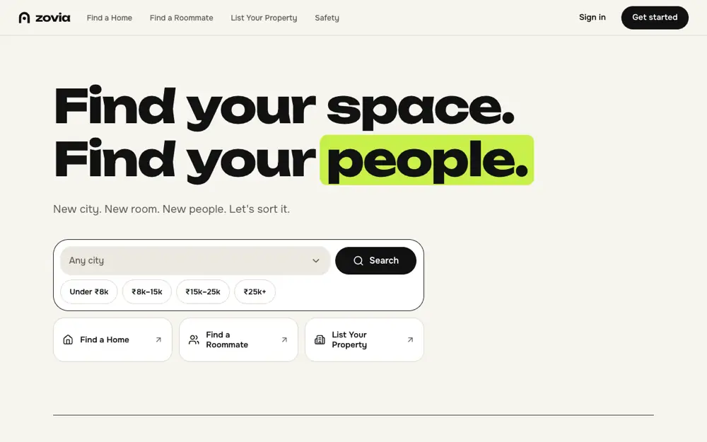
<br/><sub>A 20-second walkthrough, captured from the running app.</sub>
<br/><br/>
</div>

---

## 🎬 Take the tour

<table>
<tr>
<td width="50%" valign="top">

**🗺️ The map does the work**

Every PG is a price pin. The panel shows the rent spread for what's on screen, and tapping a pin slides up a preview with photo, rent, food and smoking rules, so you never lose your place in the list.

</td>
<td width="50%">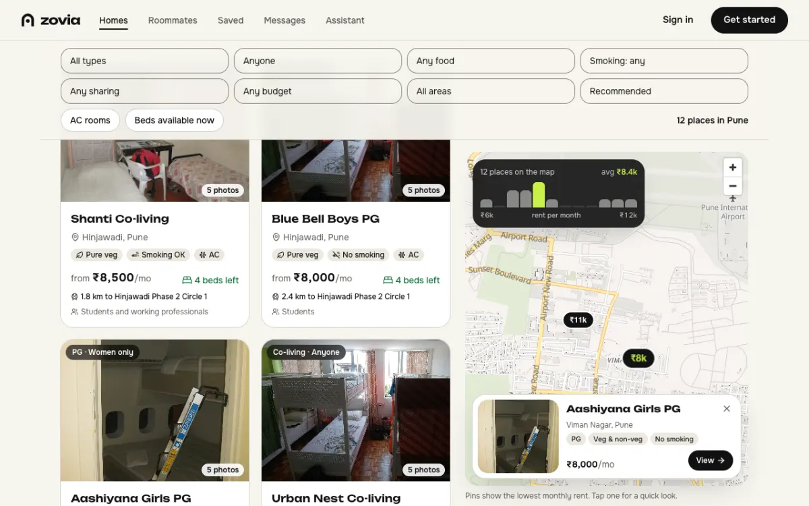</td>
</tr>
<tr>
<td width="50%">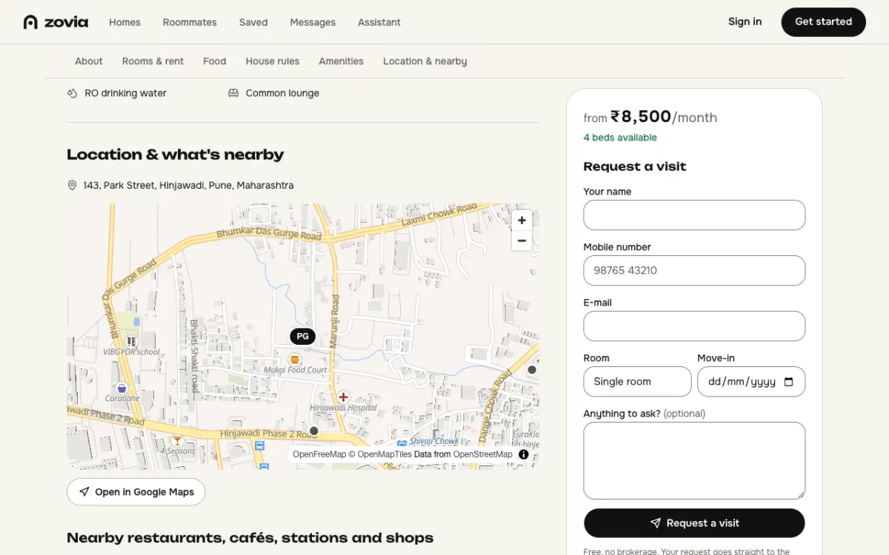</td>
<td width="50%" valign="top">

**🏠 Everything about a PG, on one page**

Rooms and rent by sharing type, deposit, meals, house rules (smoking, alcohol, guests, curfew, pets), amenities, and **1,997 real nearby places** from OpenStreetMap with walking time. Request a visit right there.

</td>
</tr>
<tr>
<td width="50%" valign="top">

**🤖 An assistant that can't make things up**

Ask in plain words. It understands cities, neighbourhoods, budgets, veg / non-veg, smoking, room type and *"cheapest"*. Every card it shows is a listing a tool returned, and ids it invents are dropped. With an Anthropic key it runs Claude with tool use; without one, a rule-based engine answers the same questions for free.

</td>
<td width="50%">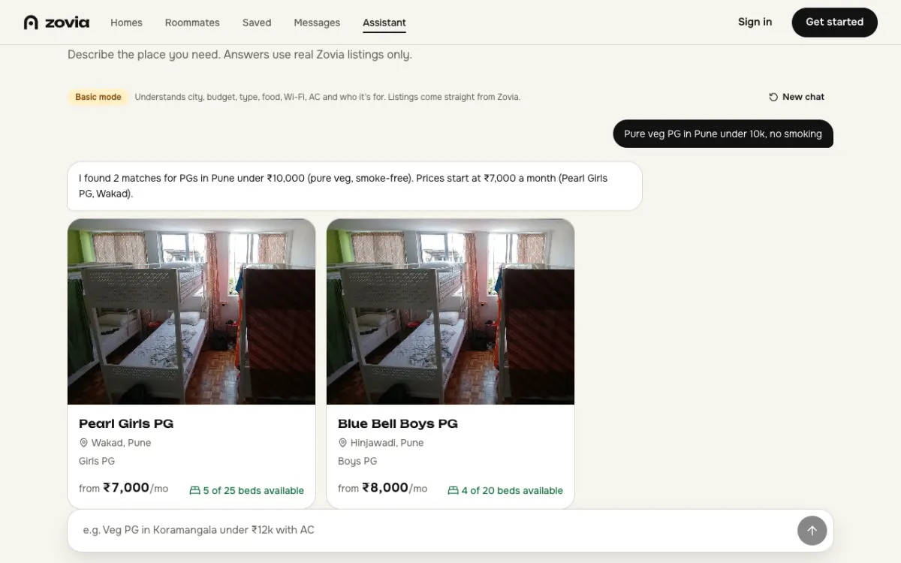</td>
</tr>
</table>

<div align="center">

**📱 Built for the phone in your hand**

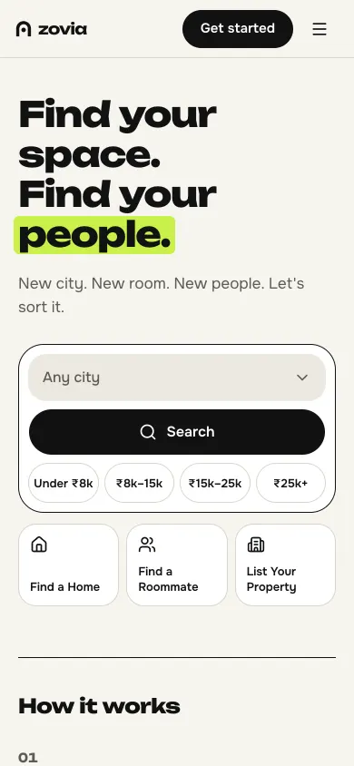&nbsp;&nbsp;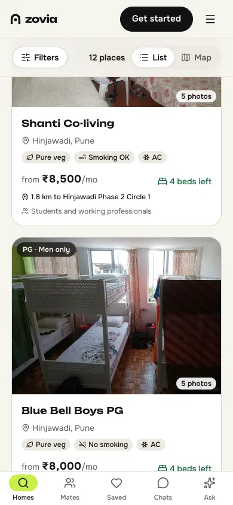&nbsp;&nbsp;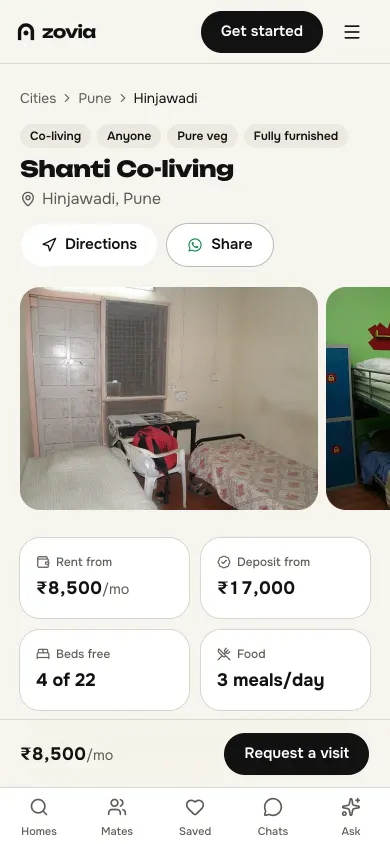

<sub>Responsive from 320&nbsp;px to 4K, installable as an app (PWA), with a bottom tab bar, folding filters and 16&nbsp;px inputs so iPhones never zoom.</sub>

</div>

---

## ✨ What's inside

| | For people looking for a home | For owners | For the developer |
|---|---|---|---|
| 🔎 | 25 tier 1 and tier 2 cities, 109 neighbourhoods, 218 PGs, hostels and co-living | List a property: rooms, beds, photos, rules, map pin | Admin panel: review listings, users, reports, contact inbox, audit log |
| 🧾 | Honest rent by room type, deposit, food, house rules | Booking requests to accept or decline | Developer-only access (`ADMIN_EMAILS`) |
| 🗺️ | Map with price pins, rent chart and tap-to-preview | Enquiries and messages | Health checks, structured logs |
| 🤝 | Roommate matching with a compatibility score, then chat | Verification and reviews | Load-test and QA scripts |
| 🛏️ | Book a bed; one live booking per bed, guaranteed | | Docker + nginx deployment |

---

## 🏗️ How it works

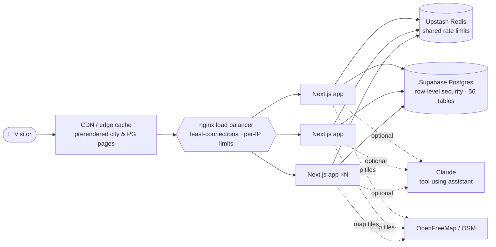

- **Next.js 16 App Router** with Partial Prerendering: city and PG pages are prebuilt and served from the edge; only personal parts render per request.
- **All writes go through the server.** The browser never talks to the database directly for data; 55 API routes share one handler that does origin checks, authentication, rate limiting and validation (Zod) before any business code runs.
- **The database is the final authority.** Every one of the 56 tables has row-level security, bookings are created by a single SQL function that locks the bed row, and unique indexes make a second live booking of a bed impossible.
- **Stateless app servers.** Sessions live in cookies and state lives in Postgres and Redis, so you can run as many copies as traffic needs.

<details>
<summary><b>📂 Project structure</b></summary>

```text
zovia/
├── src/
│   ├── app/                    Routes (Next.js App Router)
│   │   ├── (marketing)/        Home, about, contact, safety, legal
│   │   ├── (app)/              Cities, search, PG pages, bookings, roommates, messages, assistant
│   │   ├── (auth)/ auth/       Sign in, sign up, password reset, e-mail confirmation
│   │   ├── owner/  admin/      Owner portal and the developer's admin panel
│   │   └── api/v1/             55 JSON API routes
│   ├── features/               One folder per domain: schemas, service, repository, components
│   │   ├── catalog/            25-city PG catalogue, nearby places, city browser, PG page
│   │   ├── assistant/          Claude tool loop + rule-based fallback
│   │   ├── bookings/ properties/ roommates/ messaging/ owner/ admin/ ...
│   ├── server/                 Server-only: auth guards, HTTP handler, rate limits, e-mail, Supabase clients
│   ├── components/             Shared UI (layout, feedback, PWA, shadcn-based primitives)
│   └── lib/                    Isomorphic helpers: formatting, navigation, site config
├── supabase/                   31 migrations, 11 SQL test files, seed data
├── tests/e2e/                  Playwright journeys (desktop + phone)
├── loadtest/                   Spike test, booking stampede QA, k6 scenario
├── deploy/                     docker-compose + nginx load balancer
├── docs/                       Platform spec and README assets
└── public/                     Photos (Wikimedia Commons, credited), icons, service worker
```

</details>

---

## 🔥 Battle-tested

Everything below was run against the real app and a real Postgres database, on one laptop.

### 🛏️ 200 people, one bed, the same half-second

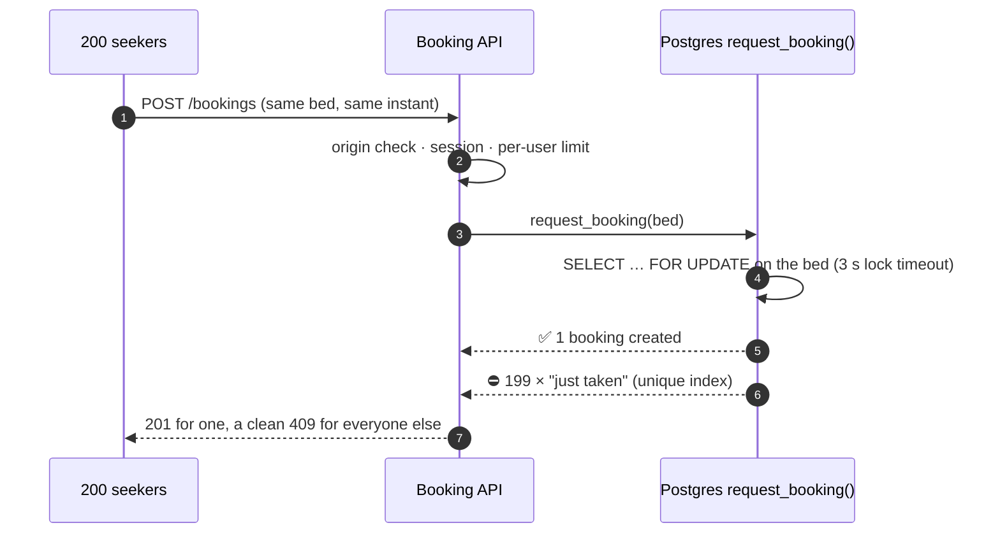

| QA check | Result |
|---|---|
| 200 users book the same bed at once | **1 booking, 199 clean "just taken", 0 server errors, 0.5 s** |
| Full journey: request → owner accepts → seeker cancels → bed rebooked | ✅ |
| Signed-out booking · past date · owner booking own PG · second bed in same PG | refused with clear messages ✅ |
| Reading someone else's booking | "not found" (it doesn't even confirm it exists) ✅ |
| Booking from another website (CSRF) | blocked ✅ |
| Owner submits → non-developer approves → developer approves → listing goes live | 403, then published ✅ |
| Crawl of every page signed in as admin | **278 pages, 0 broken** ✅ |
| Playwright journeys on desktop and phone | **15 passing** ✅ |
| Unit tests | **713 passing** ✅ |

### 🌊 Traffic spike through the load balancer

| Scenario | Result |
|---|---|
| 20,000 requests, 1,000 at once, 4 app copies behind nginx | **100% answered**, 0 errors |
| 200,000 requests, 2,000 at once (machine at load 25 on 8 cores) | **99% served, 1% told "busy, retry in 2 s"**, 0 crashes, 0 × 502/504, 0 dropped connections |
| One IP fires 2,000 requests at once | 50 allowed, 1,950 rate-limited; a normal visitor at the same moment: instant |

**Honest note on "a million users":** one laptop can't generate a million users, and no code alone can promise it. What the tests prove is the *shape* of the system: it scales by adding app copies (they share nothing but Postgres and Redis), pages come from the CDN, and when a server is full it says *"busy, retry"* instead of crashing. For a real million-user event, run [`loadtest/k6-spike.js`](loadtest/k6-spike.js) on k6 Cloud against staging, size Supabase and its connection pooler for the peak, and let Vercel (or `--scale app=N`) add servers.

---

## 🛡️ Security


- **Developer-only admin.** Admin and moderator powers only work for e-mails in `ADMIN_EMAILS` (server-only). Even an account that holds the admin role in the database gets a 403 if it isn't on the list.
- **Private by default.** Every account, booking, message, owner and admin API needs a session and the right role. The only open endpoints are what visitors need: search, PG details, map data, the contact form and a bare health check.
- **Passwords and sessions.** Sign-in is limited per IP and per account, error messages never reveal whether an e-mail exists, cookies are `HttpOnly`, `SameSite=Lax` and `Secure`. The local demo store hashes passwords with scrypt and keeps only hashes of random 256-bit session tokens.
- **Browser hardening.** Strict Content Security Policy, HSTS, no framing, cross-origin isolation headers, same-origin checks on every write, and `noindex` on private areas.
- **Database.** Row-level security on all 56 tables, no anonymous write grants, privileged actions only through audited `SECURITY DEFINER` functions.
- **No secrets in the browser.** API keys, the contact inbox and the admin list live only on the server.

---

## 🧰 Tech stack

| Layer | Choice | Why |
|---|---|---|
| Framework | **Next.js 16** (App Router, Partial Prerendering, Server Actions), **React 19** | Static speed for listings, server rendering for anything personal |
| Language | **TypeScript** (strict), **Zod 4** | One schema validates the form, the API and the database input |
| UI | **Tailwind CSS v4**, shadcn-style primitives, lucide icons | Small, consistent, accessible |
| Data | **Supabase**: Postgres + PostGIS, Auth, Storage, Realtime | Row-level security, SQL functions for anything that must be atomic |
| Maps | **MapLibre GL** + OpenFreeMap tiles, OpenStreetMap places | No API key, no per-load cost |
| AI | **Claude** (Anthropic SDK) with tool use; rule-based fallback | Answers grounded in real listings |
| Scale | nginx, Docker, Upstash Redis rate limits, CDN caching | Add servers, not rewrites |
| Quality | **Vitest** (713), **Playwright** (desktop + phone), SQL tests, k6 | Tests from the database up to the browser |

---

## 🚀 Run it locally

```bash
git clone https://github.com/SayAn1-dls/Zovia.git && cd Zovia
pnpm install
cp .env.example .env.local      # works as-is in demo mode; add Supabase for the full app
pnpm db:start                   # optional: local Supabase in Docker (all migrations + seed)
pnpm build && pnpm start        # http://localhost:3000
```

Without Supabase the app runs on a built-in demo store, which is handy for a quick look. With Supabase (local or cloud) every feature is on. Admin access: put your e-mail in `ADMIN_EMAILS` and give the account the `admin` role (`scripts/grant-admin.sql`).

<details>
<summary><b>🧪 Tests, QA and load tests</b></summary>

```bash
pnpm verify                                   # lint + types + 713 unit tests
pnpm db:test                                  # SQL tests (RLS, bookings, messaging …)
PLAYWRIGHT_BASE_URL=http://localhost:3000 PW_CHANNEL=chrome pnpm exec playwright test --project=chromium --project=mobile-chrome
node loadtest/spike.mjs http://localhost:3000 20000 1000          # quick spike
node loadtest/booking-qa.mjs http://localhost:3000 <property_id> <bed_id> 200   # booking stampede
k6 run -e BASE_URL=https://staging.example loadtest/k6-spike.js     # big runs
```

</details>

<details>
<summary><b>☁️ Deploy</b></summary>

**Vercel:** import the repo and set the variables from `.env.example`: at least `NEXT_PUBLIC_SITE_URL`, `NEXT_PUBLIC_SUPABASE_URL`, `NEXT_PUBLIC_SUPABASE_ANON_KEY`, plus `ADMIN_EMAILS`, `UPSTASH_REDIS_REST_URL` / `_TOKEN` for shared rate limits, and optionally `AI_PROVIDER_API_KEY`. Load balancing and autoscaling are built in.

**Your own servers:** `deploy/` has a Dockerfile-based stack with nginx in front:

```bash
docker compose -f deploy/docker-compose.yml --env-file .env.production up -d --build --scale app=4
```

**Contact e-mail:** messages go to `CONTACT_INBOX` (server-only) through Resend, or FormSubmit when Resend isn't configured. The very first FormSubmit message sends an "Activate form" e-mail to the inbox; click it once.

</details>

---

## 🗺️ What's next

- Real owner listings replacing the sample catalogue city by city
- Online payment of the deposit (Razorpay integration is wired, keys pending)
- Push notifications for booking responses
- k6 Cloud run at production scale before launch

---

<div align="center">

Built by **[Sayan Bhattacharya](https://github.com/SayAn1-dls)**

<sub>Photos: Wikimedia Commons (credited in-app at <code>/about</code>) · Map data © OpenStreetMap contributors · Catalogue listings are clearly marked samples.</sub>

</div>
